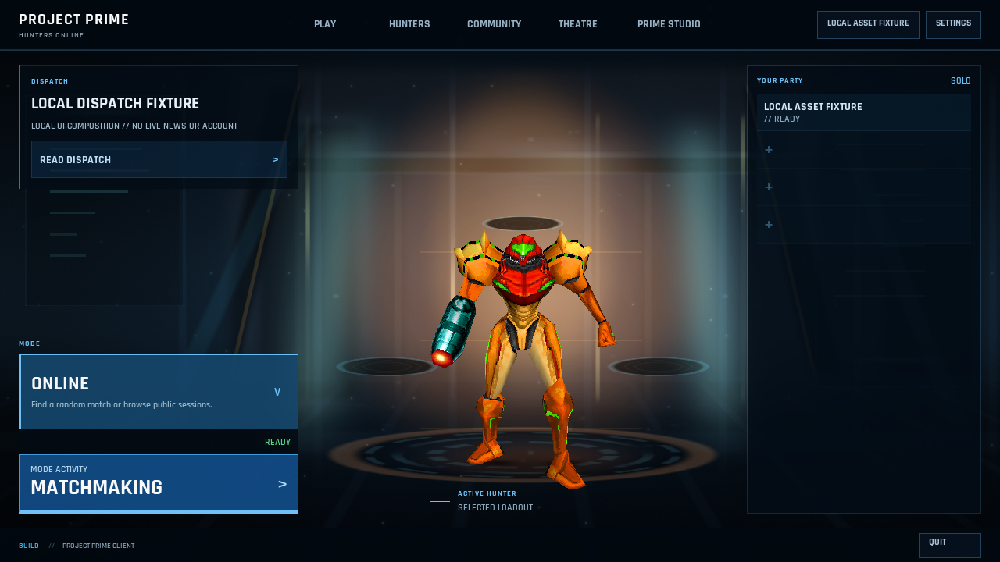
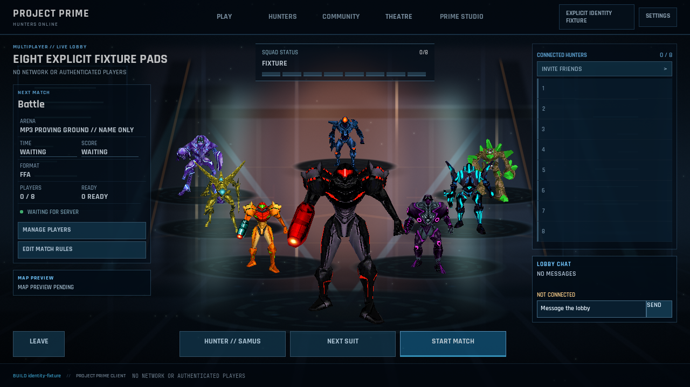
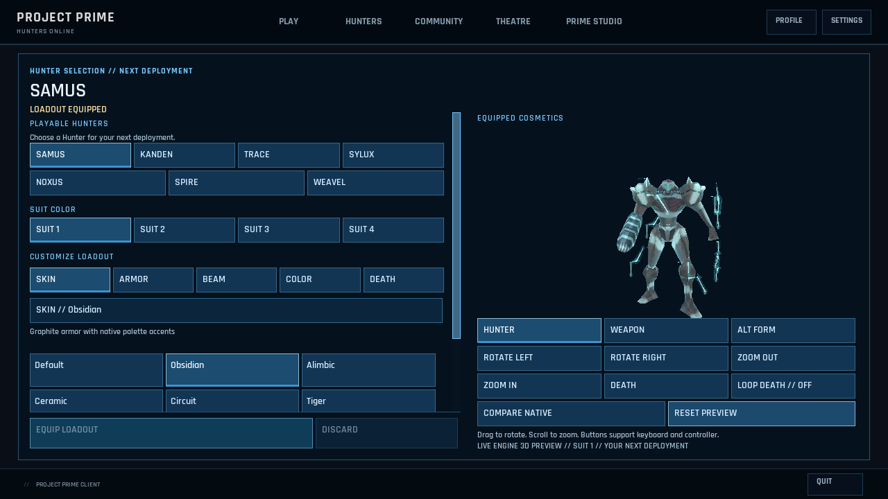
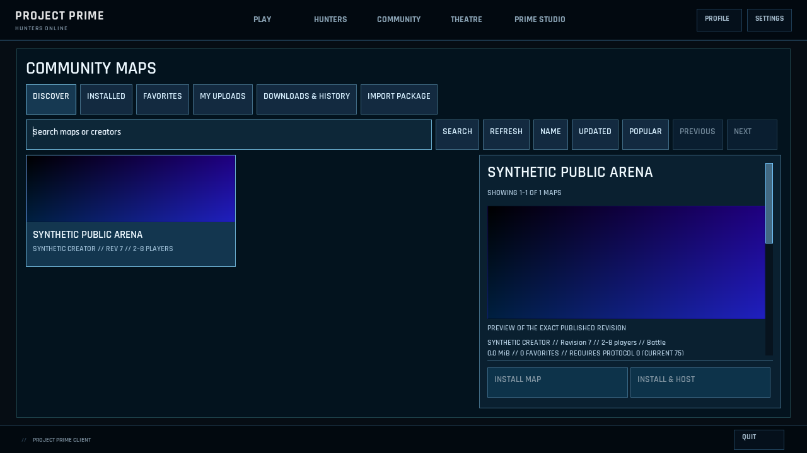

# RmlUi experience improvements — 20 October 2026

## Home and Lobby

Home now gives the engine-rendered Hunter a larger central composition. Activity selection and deployment stay at the bottom of the fixed left rail; Dispatch remains reachable even on short windows. Party and friends share one secondary scroll region. The existing routes, service bindings and four party seats remain intact.

Lobby now presents compact match facts on the left, all eight initial roster rows on the right at desktop size, a separate chat history, and persistent bottom match controls. Time and score open the existing authority-aware rules editor. Short touch and large-text windows scroll the right column when necessary, preserving every roster row and chat action. At 640 pixels the center prioritizes the local Hunter; some outer remote silhouettes sit behind the rails.

The shared shell uses a compact single navigation row at 640 pixels, with a separate utility row for large text. The Studio label shortens without changing its accessible name.

## Validation

Tested on DESKTOP-94724L4, NVIDIA RTX 5080, OpenGL 4.6. Native DLL SHA256: `e87766fc9d48beac8485a46fb092cb61e6c3d3136015c0e025869735cf5d80bb`. Isolated user data referenced the user's extracted AMHE1 game assets, with no production settings or saves copied. Screenshots use explicit local fixtures, not live players or accounts.

- Authored asset validation: 150 markup/style files.
- Native CPU layout: 87 documents, 12 viewport/accessibility cases; 2,669 checks, zero failures. Nine detailed fixtures produced 81 native framebuffer screenshots. The Lobby fixture now checks that all eight initial roster rows fit on desktop without scrolling.
- Actual Hunter meshes, Home party pads and eight-pad Lobby: passed at 1280×720 and 640×360 (693,230 and 143,053 assertions respectively; assertion totals include per-frame invariants, not distinct workflows).
- Actual Lobby interactions: passed at 1280×720 and 800×600, including authority-aware rules drafts, readiness, teams, maps and chat.
- Studio workspace suite: passed, including Home rails, full settings and version management.
- Corrected one stale acceptance assertion to recognize the already-existing Riftline M7 rule at index 18 and reject index 19.

The compact touch classes and large text were exercised on Windows; this is not a claim of physical Android-device qualification. Mac fallback was unnecessary for this phase. Detailed local reports and captures are retained under `artifacts/rmlui-experience-20261020/phase1-final`.

## Hunter and Community

The independent Hunter picker now exposes catalog-backed labeled choices: seven skins per Hunter, 21 armor effects, eight death presentations, nine beams and nine beam colors. Category tabs keep the choice list manageable; actual palette swatches identify effects and colors. Stable option IDs support native focus. The existing lobby-authoritative identity picker remains separate.

Equip Loadout preflights both existing persistence owners, saves Hunter/suit and equips cosmetics through their existing services. These stores are not transactional: a partial failure is identified explicitly and the failed cosmetic draft remains available for retry. Failed or cancelled asynchronous work cannot silently discard an unpersisted draft or overwrite a concurrent external change. Durable local equip and pending account sync remain distinct. Disabling Equip restores focus to an enabled category immediately.

The real engine preview accepts drag rotation and wheel zoom inside its measured native rectangle. Window/framebuffer scaling, foreground ownership, focus loss, modal cover, resize and disposal fence those gestures. Existing buttons remain available to keyboard/controller routing. The preview continues to restore canonical engine, RNG and cosmetic globals after rendering.

Community now presents preview cards beside a selected-package pane with fixed Install/Host actions. Exact revision PNG previews use two card download workers and two card decode workers, capped at 384 pixels per card texture. The selected full preview remains independent. Retired requests cannot publish stale images; unavailable previews use a labeled fallback. Package hashes, exact links, reporting and revision history remain available through Package Details. Short windows use compact text cards and one horizontal tool strip, preserving full selected metadata and action access.

Validation includes the complete native layout matrix, real mesh rendering, direct pointer/keyboard catalog selection, combined equip persistence, gesture containment and cancellation, Community library/import/history/report flows, and bounded preview download/decode/disposal fixtures. A native framebuffer test samples pixels from an explicitly generated synthetic PNG to prove that a card paints the downloaded/decoded texture. That test pattern is not map artwork.

### Native focus correction

At 640×360, a wheel scroll followed by programmatic or keyboard/controller focus could leave the focused identity card clipped above its viewport. Pinned RmlUi 6.3's instant `ScrollIntoView` changes the position without retiring its wheel controller; a later update could therefore move the control away again. The bridge now retires that pending target through a zero-distance Auto scroll before positioning focus. Keyboard focus changes use the same fence; normal wheel motion retains its existing behavior. Identity cards request centered focus. Native pointer and Tab tests verify the full card remains inside the actual clipped viewport.

Windows native layout validation for this phase passed 2,725 checks across 87 documents and 12 viewport/accessibility cases. Actual-model tests passed at both 1280×720 and 640×360; the latter produced 189 captures and 143,503 assertions, including per-frame invariants rather than that many distinct workflows. Portable Hunter acceptance passed 246 assertions; managed runtime/ABI/lifecycle checks and Community preview/library/import/history/report tests also passed. Detailed local evidence is retained under `artifacts/rmlui-experience-20261020`.

The final Hunter/Community native source fingerprint is `dee93abdde6a083d2eb3e6d7e7d963800d05d828bc5aa490fe1af1f6d17f560d`; the Windows DLL SHA256 is `7fee853343dd34403e5720f1d89d6c64d3d9a15f45fe9b64730d4f9df9abdd84`. All 1,912 tracked production C#/C++/header/project files matched the tested source snapshot. The final 1280×720 actual-model run passed 693,682 assertions; the new native library also passed 51 native bridge checks and 12 Home checks.

