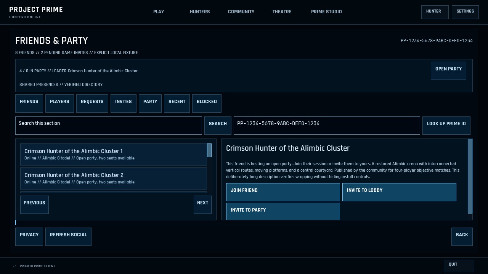
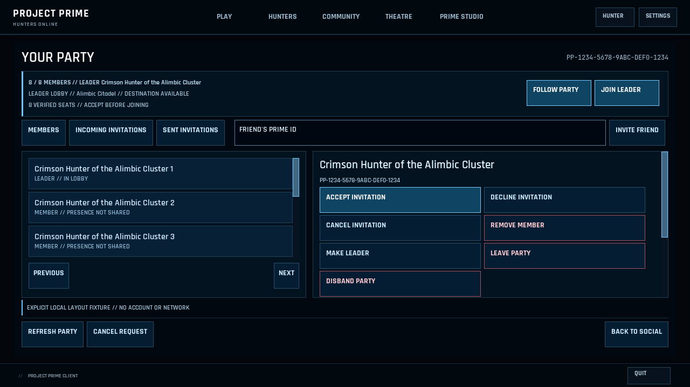

# Social, Party and Settings — 20 October 2026

This follows the [Home, Lobby, Hunter and Community implementation](rmlui-experience-2026-10-20.md).

## Behavior

Friends & Party now puts verified party membership, leader and shared destination above the directory. Pending actionable game invitations are counted independently of the selected tab. The presenter reads the existing shared Party controller with account identity checks. Shared presence counts retain their actual meaning; they are not labeled as online players. Join, Invite and Accept precede destructive membership operations. Privacy controls expand on demand, and Back remains outside the scrolling workspace.

Party presents membership, destination and reservation facts beside Follow Party and Join Leader. Secondary destination commands live in the selected detail pane. Desktop tabs and the invite form share one row, leaving three complete initial member rows visible at 1280×720. Compact windows scroll the body while retaining the destination facts and footer access. Existing authority, confirmation, cancellation and account fences remain in their controllers.

Lobby metadata has a 12-pixel floor, with compact action labels at 14 pixels. The desktop eight-row roster still fits. Full Settings now authors 96 initially hidden row containers instead of 180, and publishes only the active category. Its markup shrinks from 156,483 to 88,495 bytes. The largest current form is Gamepad with 91 rows, followed by Touch with 88. A capacity guard rejects overflow explicitly instead of silently truncating a future category. Seven inactive License faces start hidden and become visible through the existing presenter.

## Windows validation

Primary validation ran on DESKTOP-94724L4 with an NVIDIA RTX 5080 and OpenGL 4.6. All 1,912 tracked production C#/C++/header/project files matched the isolated Windows source snapshot. All 151 RML/RCSS hashes match both the layout and benchmark receipts. Final native DLL SHA256: `49dc563da9bba1408a3baecbc671c3c10dee96eaae8fadc50ee82b2c2cc0580d`.

- Native layout: 87 documents, 12 viewport/accessibility cases, 10 detailed fixtures, 90 framebuffer captures, 3,211 checks and zero failures.
- Final interactive OpenGL suites: Social invites at 1280×720 and 640×360; Party and Party Queue at 1280×720 and 800×600; Studio workspace (including full Settings) and License at 1280×720. All eight cases passed with the final native library and assets.
- The final library also passed Hunter/Community Library and downloaded-thumbnail framebuffer coverage from the preceding phase.
- Portable Settings acceptance passed 152 assertions on Windows and Mac, including category budgets, authored IDs and the overflow guard. Portable Social and managed/native runtime contracts passed as well.
- No physical Android device was attached. Compact touch classes, large text, pointer and keyboard routing were exercised on Windows; these results do not establish physical Android or controller hardware qualification. Directory and membership fixtures use no live accounts or matches.

## Native CPU measurements

The [ABBA receipt](rmlui-social-settings-2026-10-20/windows-cpu-abba.json) retains all 800 raw samples, asset fingerprints and summaries. The same final native DLL measured the merged Hunter/Community assets and final Social/Settings assets in before/after/after/before order, 20 cycles per arm, after warming each fixture. There were zero benchmark errors. Each page has 40 samples per variant at 1280×720.

| Operation | Before median / P95 (ms) | After median / P95 (ms) |
| --- | --- | --- |
| Full Settings document open | 10.104 / 12.414 | 5.237 / 6.611 |
| Full Settings first update/render | 4.303 / 6.036 | 2.665 / 3.102 |
| License document open | 1.547 / 1.610 | 0.972 / 1.049 |
| Social first update/render | 0.800 / 0.989 | 0.733 / 0.847 |
| Party document open | 0.938 / 1.069 | 0.987 / 1.054 |
| Party first update/render | 0.706 / 1.042 | 0.714 / 0.786 |

Settings median parsing/composition improved 48%, and its first CPU update/render improved 38%. Party median opening cost increased by 0.049 ms; this is retained in the result rather than presented as a universal speedup. Other previously optimized pages remained broadly similar.

These are native CPU call costs with synthetic service bindings, not FPS, GPU cost, display cadence or complete network journeys. Process-local font/resource caches may persist across arms; ABBA ordering reduces order bias without removing environmental noise. Actual OpenGL interaction tests above independently cover the functioning screens. Detailed local reports and captures remain under `artifacts/rmlui-experience-20261020/phase3-final`.
