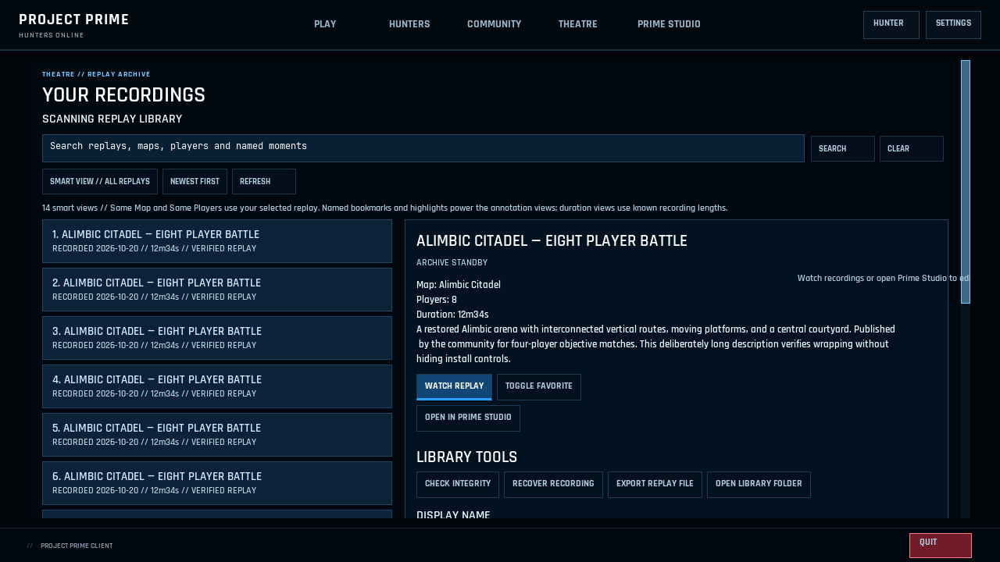
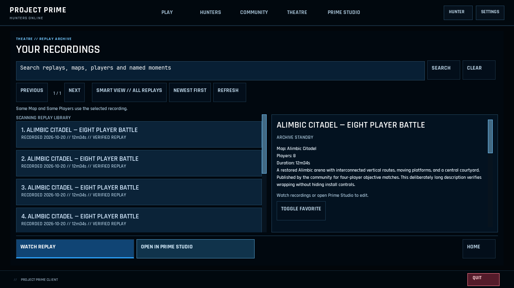
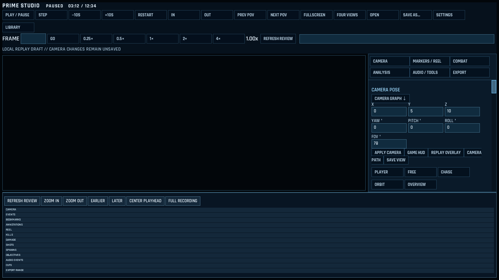
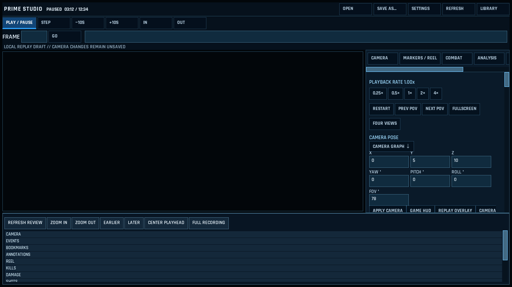
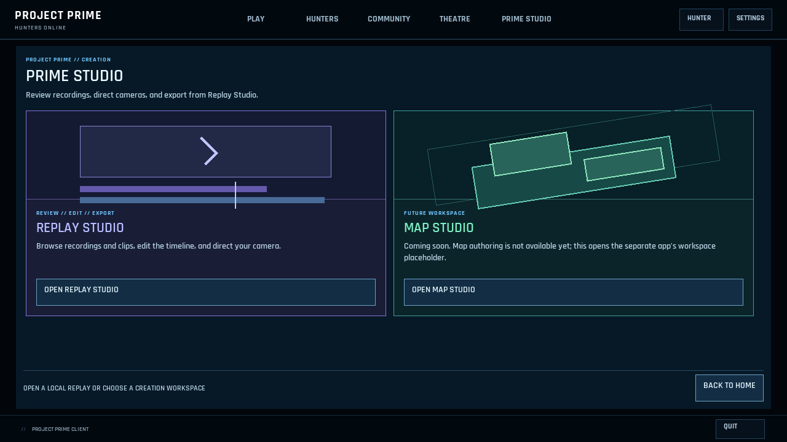
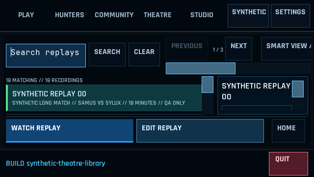
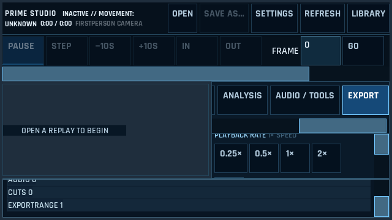

# Theatre, Prime Studio and remaining screens — 20 October 2026

Implemented against main `c701ba317`; validated production and test source is committed as `3d528cbee`. The [ranked audit](rmlui-remaining-audit-2026-10-20.md) covers all 87 authored documents, distinguishing mounted workflows from retained and auxiliary surfaces.

## Implemented behavior

Theatre separates the archive collection from selected metadata and file tools. Watch Replay, Open/Edit in Prime Studio and Home stay outside those scroll regions. Pagination shares the discovery toolbar, freeing collection height. The real menu owner hides empty notice boxes and exposes the no-match message only when appropriate; clearing the search removes it again. Search, smart views, sorting, favorites, integrity/recovery/import/export, organization and confirmed deletion retain their IDs and actions.

Playback keeps Library and Studio in its top navigation, with seek/playback controls outside secondary utility scrolling. Its transparent engine viewport remains the same native element. The launcher chooser leads with available Replay Studio, explains the future Map workspace honestly, and keeps status and Back separate from the reading area. Map Studio availability and ownership are unchanged.

The replay workspace separates file/navigation commands, primary playback and seeking. Rate, POV and view controls are grouped with the camera inspector; every existing command remains available. Inspector tabs scroll horizontally and its content scrolls independently. Five inactive inspector faces start hidden, with existing presenter bindings selecting the visible face. Controls use readable type, explicit large-text rules and 48dp touch targets. Short touch or large-text layouts scroll the timeline panel as a whole, preserving access to every lane and the actual presented-picture clipping ticket.

Studio retains its identity in compact application headers. Theatre uses a single 64dp large-text header at logical 600–640dp in short windows, where all five destinations and utilities fit; its wider archive column leaves a complete initial row visible even with touch and large text combined. This Theatre-specific override preserves the other game pages' existing shell layout.

Journal now lays out its header, entries and footer in flow rather than relying on fixed offsets, with explicit touch/large-text controls. Narrow Offline rules/arena dialogs now fit their authored content inside the padded card. Campaign, server browsing, news, updates, setup and confirmation surfaces gained populated native qualification fixtures. In-flight Aim Lab and postmatch lifecycle changes were kept with their existing owners.

## Before and after

These are native OpenGL framebuffer captures with explicitly synthetic UI state. The workspace preview is intentionally empty: these pictures do not depict an actual replay scene. The library fixture's recording names and metadata are synthetic.

Theatre before: launch actions follow the archive and supporting tools in the page scroll.

Theatre after: separate browsing/details areas and a persistent launch footer.

Workspace before: wrapped navigation mixed with playback controls and very small type.

Workspace after: explicit command groups, more preview height, readable controls and intentional tab/timeline scrolling.

Actual 640×360 combined touch/large-text fixtures verify the whole initial archive row and lower timeline tracks independently.

## Executed validation

Primary host: Windows x64, DESKTOP-94724L4, NVIDIA RTX 5080. The native source fingerprint is `63103845dbe581aa41f6498a6fa5584f6072a6b5a3b6258d1d38ecc780a06d60`; the unchanged matching native DLL SHA256 is `49dc563da9bba1408a3baecbc671c3c10dee96eaae8fadc50ee82b2c2cc0580d`.

- All 2,041 selected source/build/test/harness files match the Windows snapshot. All 151 authored UI hashes match the final layout report and both benchmark receipts; all four font hashes match baseline, candidate and source.
- Native matrix: 87 documents, 12 viewport/density cases, 32 populated fixtures, **7,773 checks and zero failures**. No initialization, page, open or close errors. There are 288 before and 288 after framebuffer captures, plus nine accessibility captures. The same final harness reports 192 baseline failed checks; these include newly required container/target assertions and are not 192 distinct product bugs.
- All eight final interactive native GL cases passed: Library and Workspace at 1280×720, 640×360, large-text 640×360 and combined touch/large-text 640×360. Library passed 115 assertions per case, including actual search/empty-state/clear, paging, complete initial row, header containment/no overlap, reachable tools and Home routing. Workspace covers every inspector tab, camera drafts, audio/tool choices, export controls, independent scrolling, lower-lane visibility and exact presented-ticket clipping.
- Additional Windows suites passed: full Studio workspace at 1280/640; playback/bookmarks/ranges/camera/export/editor at 1280/640; touch-only workspace at 640; density-2 workspace at physical 1280×720; retained synthetic map-editor fixture (2,480 assertions), Studio build, real private replay-file owner and Studio owner (686 assertions).
- Mac checks also passed: Studio controllers/file guards/intents (433), playback (188), source-linked editor/publication checks, full live-menu owner contracts and managed runtime/lifecycle checks. Authored validation resolves all 151 markup/style assets.

Qualification corrected existing test assumptions: Boolean schema fields resolve their actual visible slots, border-box comparisons allow the measured subpixel/one-pixel edge rounding, and the movement fixture recognizes current main's Traversal profile v5. Production geometry and gameplay behavior were not relaxed.

The [Windows receipt](rmlui-theatre-studio-2026-10-20/windows-evidence.json) and [layout summary](rmlui-theatre-studio-2026-10-20/windows-layout-summary.json) retain provenance and scope. Native events are injected into real RmlUi controls. Synthetic services and private files do not establish live-account, actual replay-world, encoder, physical controller/touch or Android-device qualification. Owned QA processes and scheduled tasks were cleaned up.

## Measured CPU tradeoffs

Two same-DLL ABBA runs each used 320 samples, 20 cycles per arm, four explicitly selected pages and zero errors. [First raw receipt](rmlui-theatre-studio-2026-10-20/windows-cpu-abba.json) and [repeat](rmlui-theatre-studio-2026-10-20/windows-cpu-abba-repeat.json) retain every sample, asset hash, median and P95. The benchmark command is documented in `tools/rmlui-layout-check/README.md`.

| Page | Open median before → after, ms | First update/render median before → after, ms |
| --- | --- | --- |
| Theatre library | 1.154 → 1.108 | 0.914 → 0.814 |
| Playback | 0.516 → 0.552 | 0.249 → 0.270 |
| Replay workspace | 13.452 → 15.033 | 8.147 → 9.254 |
| Studio chooser | 0.687 → 0.669 | 0.464 → 0.411 |

The repeat confirms about 11% less library first-layout work. Chooser results are effectively flat across repeats. The readable workspace layout accepts 0.87–1.11ms more first update/render work and 1.19–1.58ms more document-opening work; Playback adds 0.02–0.026ms. Median immediate idle update/render remains 0.0006ms in both variants. This is an initialization tradeoff, not a universal performance improvement.

These measurements cover native CPU parsing/composition, synthetic publication and draw-list generation with process-local caches. They do not measure FPS, GPU cost, frame cadence, complete application startup or actual replay-world rendering. Detailed local artifacts remain under `artifacts/rmlui-experience-20261020/phase4-final` and `phase4-qualified`.
