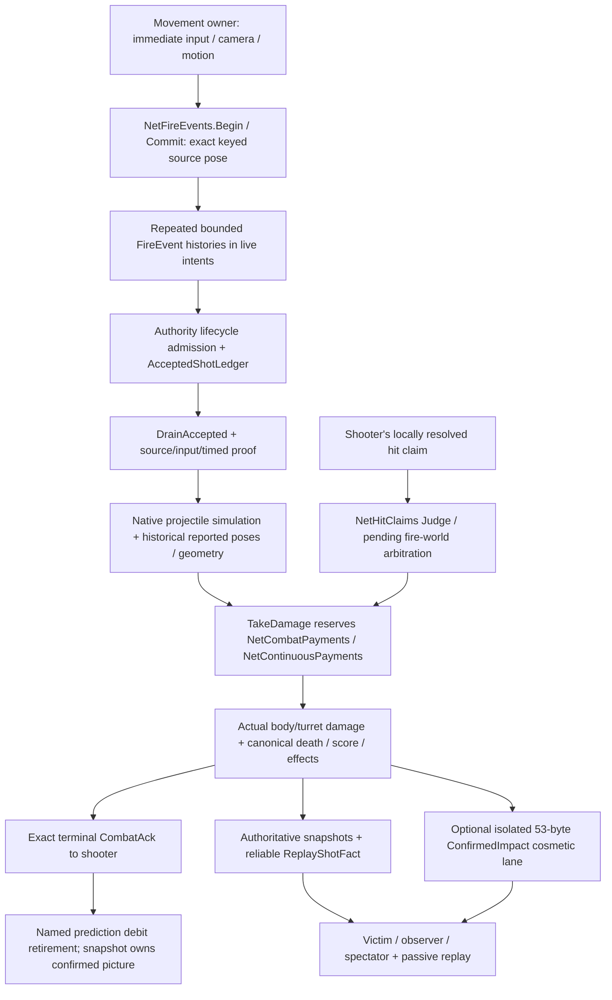

# NCX-00: competitive netcode baseline

Audit date: 2026-10-19. Prime source: `2f169d9d1e9eb0c1d2cb6edeb04837820a760a01`.
Fruity native master: `12ff677b9700bc8dabde37eb9a3fdd10c62b87b6`.
Both refs were refreshed before implementation. The user explicitly selected the
[Competitive Netcode Overhaul](ncx-implementation-plan.md), overriding the conflicting
Custom Weapons title in the initial request. This audit adds documentation and baseline
evidence; it changes no gameplay, movement, packet, replay or production configuration.

## Source, overlap and evidence ownership

No Prime PRs were open at the audit. Recent merged overlapping work includes CW-03
offline custom combat (#725), Momentum movement/contact and authority bot parity (#724),
CW-02 custom state (#722), Momentum replay rules (#721), and Insta-Gib presentation (#716
and subsequent main commits). These changes are included in the frozen Prime baseline;
none is silently compared to the plan's older `dc7f0970` snapshot. CW-03 remains an offline
developer fixture, not a networked weapon or a certified fast-settlement family.

The managed worktree is separate from the user's dirty primary checkout. Its branch is
`codex/ncx00`. Local logs, source/asset inventories and frozen build are under
`artifacts/ncx/NCX-00/` and `artifacts/ncx/baseline-prime/`. The public, source-qualified
result is [ncx-baseline.json](../../tools/nettest/baselines/ncx-baseline.json).
No extracted game files or private profiles are committed.

Host: Apple M4 Pro, arm64, 24 GiB, macOS 27.0.1 build 26A434; .NET SDK 10.0.401,
runtime 10.0.12. The PATH installation is runtime-only; commands use the installed SDK's
`dotnet` explicitly. Installed Android workload is tool discovery, not device acceptance.
This development host cannot certify Linux/Windows production cost or physical Android.

## Actual defaults at the frozen source

| Contract / setting | Source default | Runtime source |
| --- | --- | --- |
| Live protocol | **59**, exact-match Hello | `NetProtocol.cs:2546`; `SessionProtocol.cs` |
| Simulation | Fixed 60 Hz; owner-reported ordinary movement | `ARCHITECTURE-INVARIANTS.md`, `NetPlayerBridge.cs` |
| Native / Momentum movement rule | Preserve existing match-selected rule; Native default | Protocol-59 comments; `MovementModel` match policy |
| Accepted discrete playback | On unless `PRIME_ACCEPTED_SHOTS=0` | `NetFireEvents.cs:133` |
| Rewind / press age | On / on; history 128, ceiling 45 frames, configurable hard ceiling 120 | `NetUnlagged.cs:69,113–130,159,179` |
| Dynamic geometry history | Production on, diagnostic shadow off, at most 512 objects | `NetDynamicGeometryHistory.cs:24,45–46` |
| Plausible-depth policy | Shadow; no production movement enforcement | `LagCompensationPolicy.cs:25` |
| Claims | On; grace `clamp((int)(ping_ms*0.06)+20,24,72)` | `NetHitClaims.cs:76,158–204` |
| Hit prediction / marker | On / on; remote lethal prediction disabled, 1 HP floor | `NetHitPrediction.cs:77,86,449,761–784` |
| Shot proof | `PRIME_SHOT_PROOF`: Shadow default; Off/Enforce explicit | `NetShotProof.cs:38` |
| Timed grant proof | Off; `PRIME_TIMED_GRANT_PROOF=shadow` opt-in; Enforce fixture-only | `NetTimedShotProof.cs:122–127` |
| Confirmed impacts | Off; `PRIME_CONFIRMED_IMPACTS=1` opt-in | `NetConfirmedImpacts.cs:13` |
| Movement diagnostics | Off; `PRIME_MOVEMENT_VALIDATION_SHADOW=1`, hard rejections always zero | `NetMovementValidationShadow.cs:32,133` |
| Campaign evidence | Off unless `PRIME_NET2_EVIDENCE` nonblank; bounded overflow invalidates evidence | `NetCampaignEvidence.cs:21–38` |
| Performance / operator evidence | Off unless explicit output path | `NetPerformanceEvidence.cs:14–15`, `NetOperatorEvidence.cs` |
| Proposed combat fast path | Absent; no family is newly certified | No `PRIME_COMBAT_FASTPATH` implementation at baseline |

The plan and architecture prose saying protocol 57 are stale. Protocol 58 adds an
authoritative presentation rule; 59 adds the existing MovementModel-v1 semantic contract
without changing packet widths. This audit does not revert either existing feature.
The protocol number measures compatibility, not netcode quality.

## Ownership and payment flow

`NetFireEvents.Begin` freezes ShotId, source frame, fractional ACK, kind, weapon/charge,
scope/modifier context, authored muzzle/ray/aim/view/reticle, source life and selected
target (`NetFireEvents.cs:675–739`). Successful emissions alone enter repeated history
(`:749–780`): 16 retained, 14 live events, 32-frame sender retention. Fire admission
precedes movement ordering so an older carrier can recover a legal shot
(`NetSession.cs:1355–1377,1418–1440`). Admission is not payment.

The existing accepted ledger is 256 entries / 64 source frames, keyed by authority epoch,
match, shooter slot/generation/life and ShotId. A life change alone does not retire an
already accepted flight (`AcceptedShotLedger.cs:9–14,44–69`). Drain validates source pose,
source resources and timed modifiers, then uses `ModSpawnAcceptedShot`, native Spawn,
rewind and catch-up (`NetFireEvents.cs:415–524`, `PlayerEntityAcceptedShot.cs:51–112`).
Children inherit launch identity (`BeamProjectileEntity.cs:2120–2132`). Rewind uses the
authored fire ACK and restores historical geometry in `finally` (`NetUnlagged.cs:728–753,
1117–1163`). Historical positions are reported positions, not proof of reachable movement.

`PlayerEntity.TakeDamage` reserves payment before native effects (`PlayerEntity.cs:1859–1863`).
Only actual body/turret reduction commits the authoritative component outcome
(`:3147–3182`). `NetCombatPayments` owns 4,096 tombstones per shooter for 1,024 frames;
`ShotPaymentKey` includes component, victim generation/life and channel in addition to
ShotKey. Continuous damage/healing uses the existing separate tick/target/body-or-turret
payment transaction, 1,024 per owner and 1,024-frame retention (`NetContinuousPayments.cs`).
No new damage ledger is needed.

`NetHitClaims` validates lifecycle, ACK/launch order, source, weapon restrictions,
historical target contact and damage/impulse bounds, then settles in fire-world order
(`:1583–1692,2384–2515`). Pending capacity is 64/shooter, 512 total; native resolved history
is 64 per attacker/victim. Standard grace is adaptive; already-paid exact results can be
answered earlier. A legacy accepted rescue is not itself independent exact collision proof.

CombatAck is 23 bytes with claim/shot and victim lifecycle identity, terminal result,
actual damage, body/turret health, damage sequence and status (`CombatAckEntry.cs:7–36`).
It is sent only to its shooter (`DedicatedServer.cs:1335–1351`). HitClaim and CombatAck
are outside `NetReliableChannel` selective retransmission: the claim outbox owns at most
six sends, prediction release at 60 frames, and terminal identity retention for 424 frames
(`NetHitClaims.cs:251–266,560–650`). `ApplyCombatAck` reconciles the named debit
(`NetHitPrediction.cs:1656–1723`); a late receipt cannot reintroduce expired prediction.

Successful authority damage also emits a reliable `ReplayShotFact`, keyed to exact shot
and damage event (`PlayerEntity.cs:3108–3142`, `ReplayCapture.cs:184–202`). Its 8,192-entry
delivery retention may overrun the recorder without disconnecting gameplay; late joiners
start at the tail (`DedicatedServerReplayShots.cs:7–59`). Passive replicas never own live
input, damage, score or sockets. Cosmetic confirmed impacts have an isolated expendable
transport and cannot author these outcomes. Their current draw-submission counters
explicitly do not prove visible pixels.

## Weapon and source-family inventory

Native numeric IDs and MP/1P tuning/affinity arrays remain the goldens. Policies must inspect
the actual immutable mechanics, charge, affinity and match modifiers rather than promote
every shot of a named weapon. Balanced and Insta-Gib variants require independent tests.

| Weapon / source | Actual mechanics and required evidence boundary |
| --- | --- |
| Power Beam | Ordinary and charged/repeated projectile; independent source/charge/cadence and exact collision needed; held automatic source proof currently unavailable |
| Imperialist | Scoped/unscoped, affinity, Balanced and Insta-Gib variants; historical trace mode still spawns native projectile; head classification requires native historical contact |
| Volt Driver | Charged homing and affinity disrupt require lawful target/life/curve and effect evidence |
| Missile | Straight/homing, direct/splash and self-splash; endpoint distance cannot prove flight |
| Battlehammer | Ballistic gravity, multi-component Balanced burst and child lineage must preserve separate payments |
| Judicator | Ricochet ancestry/surface/path and charged affinity freeze/AOE; preserve configured Shadow Freeze rule |
| Magmaul | Ballistic direct/splash; affinity burn requires immutable source/grant/life and separate late effect |
| Shock Coil | Continuous phase/tick, target lifecycle, ammo ramp, capped healing, body/turret channels; never generic rescue plus native tick payment |
| Omega | Long-flight projectile/direct/splash; source funding currently unavailable to general shot proof |
| Weavel turret | Owner and spawned turret lifecycle, emission/refusal/retirement, form and exact component evidence |
| Morph Ball / Stinglarva / Lockjaw bombs | Authoritative birth, detonation and source life; no generic straight-ray shortcut |
| Alt/contact attacks | Boost, Spire, Noxus, Trace, Weavel use distinct historical contact geometry/current-volume fallbacks |
| Enemy/platform/bot/world/self sources | Distinct authority-owned mechanics; no human-replay suppression without explicit qualification |
| Enhanced Hunters / timed Prime, Double, Death Alt | Existing authoritative grant/source ledgers; client hints do not establish funding or effects |
| Riftline M7 / future custom | M7 currently offline only, separate immutable identity and private bounded projectiles; native accepted IDs stop at Omega; online policy must explicitly reject unknown/mismatched custom definitions |

Sources: `Formats/Enums.cs:124–154`, `Metadata/Weapons.cs`, `WeaponLagPolicy.cs`,
`NetShotProof.cs:11,198–204,262–279`, `NetContactLagComp.cs:9–15,66–94`,
`NetSelfSplash.cs:52–53`, `EnhancedHunters/EnhancedHunters.cs:143–176`,
`CustomWeapons/OfflineCustomWeaponRuntime.cs:27–37`, `CustomWeapons/RiftlineM7.cs:9–14`.

`NetTimedSourceCapabilities.cs:33–80` separates completed source-modifier evidence from
exact impact. General exact impact is UNAVAILABLE; homing/ricochet and dependent
child/continuous/turret/nonordinary families remain SHADOW_ONLY. Its overwriteable telemetry
ring is not an authorization ledger. No class is certified for new fast payment by this audit.

## Comparator and qualification limits

Fruity native protocol is 34 at the frozen source. Shooter-first human claims use zero
arbitration grace, while bots/server-shot control retain adaptive grace. That is a different
evidence/performance tradeoff, not proof of superiority. Current PRs #205/#206 hold remote
lethal prediction at 1 HP and keep authoritative death/score, superseding PR #109's old
predicted-kill behavior. Native source, not its historical C# tree, is the comparison arm.
The audit records source behavior; it has no fresh paired binary or pixel result.

The supplied plan's historical PR #109 "visibility" figures describe headless hit-log
joins, not measured framebuffer pixels. Its [test report](https://github.com/liveteklol/Fruity-Prime/pull/109#issuecomment-6062360519)
explicitly uses headless native clients. `HitLocation::Contact` logs simulation contacts;
`Synthesized` logs effect emission, and `tools/hitrig/hitloc.py` joins shooter/victim/beam
and launch frames within three frames. Those figures are useful contact/presentation-event
diagnostics but do not establish actual camera visibility or exact full-lifecycle shot
identity. Keep the supplied plan intact; use this source correction when interpreting
its historical numbers. The proposed 96%/95% actual-pixel release targets remain gates,
and cannot be directly compared to the historical 94–95%/93% event-join rates.

Retain the N13 matched p99 flags, identical-binary noise control and INCONCLUSIVE timing
as written in `docs/netcode2-n13.md`. Its live UDP settlement coverage is INCOMPLETE despite
successful gameplay/drain. N14 short eight-client canaries do not certify long soaks,
external hosting, rendered same-shot hit fidelity or all platforms. Existing 47-case native
fidelity goldens include the previously characterized one-fixed-unit missile splash Z
difference; do not regenerate a golden to hide it.

NCX-01 must establish positive actual shot/hit activity, distinct uniquely authored/
claimed/paid/visible denominators, clock domains and alignment uncertainty, an independent
collision oracle, actual framebuffer captures for victim and third observer, and A/A
variance for both binaries. Missing evidence stays NOT_RUN/INCOMPLETE. No performance,
cross-platform, visual-fidelity or supremacy gate passes merely because reference tests pass.

## Validation and rollback

The manifest binds exact source/asset/map/golden/build hashes, command routes, exit codes,
flags and scope. Discover routes in current `tools/nettest/Program.cs` and both runner help
outputs before execution. Reference compilation uses Release and
`-p:UseSharedCompilation=false`; no other worktree's build service is stopped.
Raw command logs and isolated profiles are retained locally.

Hosted CI status is a point-in-time exact-head observation in the manifest. Per the user's
instruction it is recorded without waiting for review or CI and is never assumed PASS.
No feature/default/protocol is introduced by NCX-00. Reverting this documentation-only PR
requires no runtime migration. Refresh source and rerun the scope-specific gate before
the next PR changes behavior.
